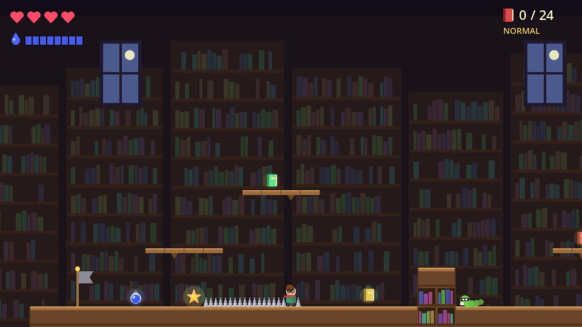
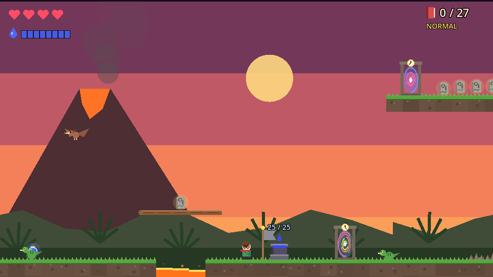
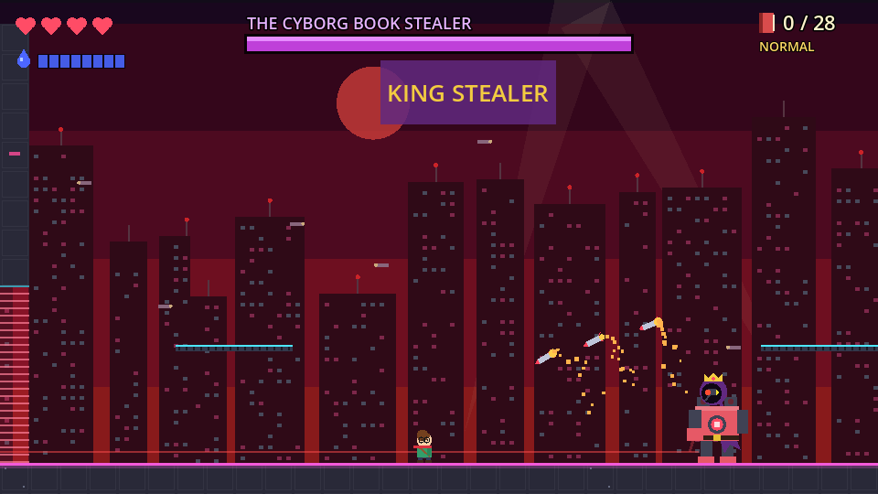

# The Evil Book Stealer

**A hooded thief has stolen every book from the Grand Library, and you're the only librarian brave enough to get them back.**

The Evil Book Stealer is a 2D platformer made with Godot. You chase the thief through the library, across the city on a skateboard, into his secret hideout, inside his evil supercomputer, back to the age of dinosaurs, and forward to the year 3000. On the way you jump, stomp enemies and throw blobs of ink, and you rescue every book you can find.

## The story, level by level

Levels 1 to 3 all take place in **Book Town**, the first area of the world map.

1. **The Grand Library.** Climb the bookshelves, stomp the bookworms, and collect the stolen books. Chase the Book Stealer to the end of the library, where he leaps out the window.
2. **The Getaway.** He lands on his feet and runs off with one last sack of books. Grab your skateboard and chase him through the city: hop the traffic cones, grind the rails, and launch off ramps. Knock books out of his sack before he jumps the wall at the end of the alley.
3. **The Hideout.** Follow him to his secret hideout, a dusty old bookshop at the edge of Book Town. Fight through the shop, then face the Book Stealer himself in the Book Town boss battle.
Levels 4 and 5 take place in **Cyberspace**, the second area, inside the Book Stealer's supercomputer.

4. **The Mainframe.** His sack was empty because he uploaded everything as e-books. Hack into his supercomputer, shut down the firewalls, dodge the security lasers, and destroy the core.
5. **System Crash.** With the core destroyed, the whole supercomputer starts crashing. Outrun a wall of corrupted data past lasers, drones and bottomless gaps, and dive into the time portal the Book Stealer escaped through.
6. **Lost in Time.** The crashing computer opens a time portal and flings you back to the age of dinosaurs. The thief is stealing the very first stories ever carved in stone. Warp through glowing time portals, outrun charging raptors, dodge meteors, and take on the Book Stealer riding his tamed T-Rex.
7. **The Year 3000.** He escapes into the future ahead of you, rebuilds himself as a cyborg, crowns himself King of the World and bans books forever. Bounce on jump pads, ride hover platforms over bottomless drops, and bring down the Cyborg Book Stealer to free the world.

## Features

- **7 levels**, each with its own look and enemies, and 4 boss fights
- **Different ways to play:** platforming, a skateboard chase, hacking terminals, an escape from a crashing computer, time travel and jump pads
- **Ink-throwing combat:** stomp enemies or hit them with ink, and refill at ink wells
- **Power-ups:** a mushroom that makes you big, invincibility stars, hearts and ink bottles
- **A world map** to walk between levels. Beat a level to unlock the next one, and replay any level you've cleared
- **Two shops** where you spend the coins you earn: the Ink & Quill (extra hearts, a bigger ink pouch, mushrooms) and the Tick-Tock Bazaar (star candy and new scarf colors)
- **Checkpoints** in every level
- **Easy, Normal and Hard modes**
- **Music:** a chiptune soundtrack with a different tune for every level and the world map (press **M** to mute)
- Keyboard and gamepad support

## How to play

| Action | Keyboard | Gamepad |
|---|---|---|
| Move | Arrow keys / A D | D-pad / left stick |
| Jump | Space / W / Up / Z | A |
| Throw ink | J / X / K | X / B |
| Restart the level | R | Start |
| Back to the world map | Esc / M | Back |

On the title screen, press **Left / Right** to choose **Easy, Normal or Hard**. The game remembers your choice. Choose **Continue** to pick up where you left off, or **New Game** to start over (it asks first, because this erases your save).

On the world map, walk with **Left / Right** and press **Space** to enter a level or a shop. In a shop, choose with **Up / Down** and press **Space** to buy.

**Coins:** you earn 1 coin for each book you rescue, plus 10 coins for beating a level and 15 more the first time you beat it. Mushrooms and Star Candy go in your bag and are used when you start your next level. Your progress is saved automatically.

**Tips:** jumping on most enemies defeats them. Bosses take extra damage when they're dizzy or overheated. Touch the flags to save your checkpoint.

## Download

Get the latest version for **Windows, macOS and Linux** from the [Releases page](https://github.com/hermeslohin/Evil_Book_Stealer/releases).

- **Windows:** unzip and run `EvilBookStealer.exe`. If SmartScreen warns you, click *More info*, then *Run anyway*.
- **macOS:** unzip, then right-click **The Evil Book Stealer.app** and choose **Open** the first time. The app isn't notarized by Apple.
- **Linux:** unzip, run `chmod +x EvilBookStealer.x86_64`, then run `./EvilBookStealer.x86_64`.

## Run it from the source code

1. Install [Godot 4.7](https://godotengine.org/download).
2. Clone this repository and open `project.godot` in Godot.
3. Press **F5** to play.

All the art is drawn in code, so there are no image files to import. The levels are text maps in `scripts/*_data.gd`, so you can edit the characters to change a layout. Difficulty settings are in `scripts/difficulty.gd`. Shop prices and coin rewards are in `scripts/progress.gd`, and the world map is drawn in `scripts/world_map.gd`.
